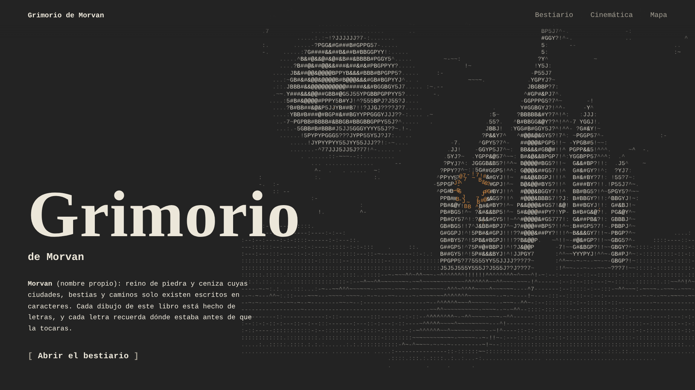

```
+-------------------------------------------------+
| G U I L L E R M O   C A R R A S C O   M A Y O R |
+-------------------------------------------------+
o==[]:::::::::::::::::::::::::::::::::::::::::::::>
```

<div align="center">


</div>

---

### ~/Dev/perfil ➜ whoami

```diff
+-----------------------------------------------------+
| guillermo@morvan: ~/Dev/perfil               [_][x] |
+-----------------------------------------------------+

~/Dev/perfil
➜ whoami
  Guillermo Carrasco Mayor

~/Dev/perfil
➜ cat hoja_de_personaje.txt
  CLASE ...... Desarrollador de videojuegos
  SUBCLASE ... Profesor de DAM y DAW
  BASE ....... Profesor de desarrollo de software
  ARMAS ...... Unity, C#, Blender, Java, Python
  EN CURSO ... Grimorio de Morvan y juego Unity web

~/Dev/perfil
➜ ls arsenal/
  unity/  c#/  blender/  java/  python/  html/  css/  js/  git/

~/Dev/perfil
➜ _
```

Hago juegos y también enseño a hacerlos. Me gusta el arte con alma retro, las herramientas pequeñas y bien acabadas, y llevar al aula lo que aprendo en los proyectos.

<p align="center">
  
</p>

---

### ~/Dev/perfil ➜ npx grimorio --build

```diff
~/Dev/perfil
➜ npx grimorio --build

+ Build OK, desplegado en Netlify
  Proyecto:   Grimorio de Morvan
  Stack:      Python + Java + HTML + CSS + JS
  Deps Java:  0
  Imagenes:   0 (todo el arte se genera por codigo)

  Siguiente misión: juego Unity para navegador
  Try to open the grimoire and move your mouse over the castle.
```

<p align="center">
  <a href="https://grimoireascii.netlify.app/">
    
  </a>
</p>

---

### ~/Dev/perfil ➜ npx contact --all

```diff
~/Dev/perfil
➜ npx contact --all

+ Canales de contacto disponibles
  LinkedIn:  /in/guillermo-carrasco-mayor
  Correo:    guillermocarrascomayor@gmail.com

  Try to say hello with the buttons below.
```

<p align="center">
  <a href="https://www.linkedin.com/in/guillermo-carrasco-mayor/">
    
  </a>
  <a href="mailto:guillermocarrascomayor@gmail.com">
    
  </a>
</p>

<p align="center"><sub><i>«Quien nombra la sombra ya no camina a ciegas.»</i></sub></p>
